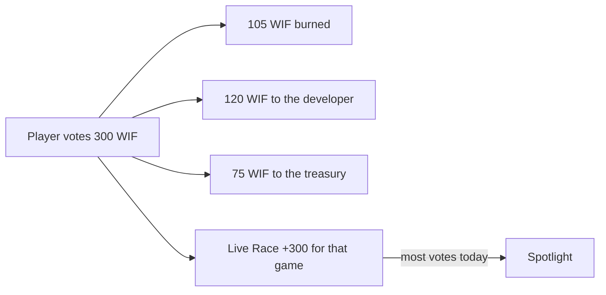
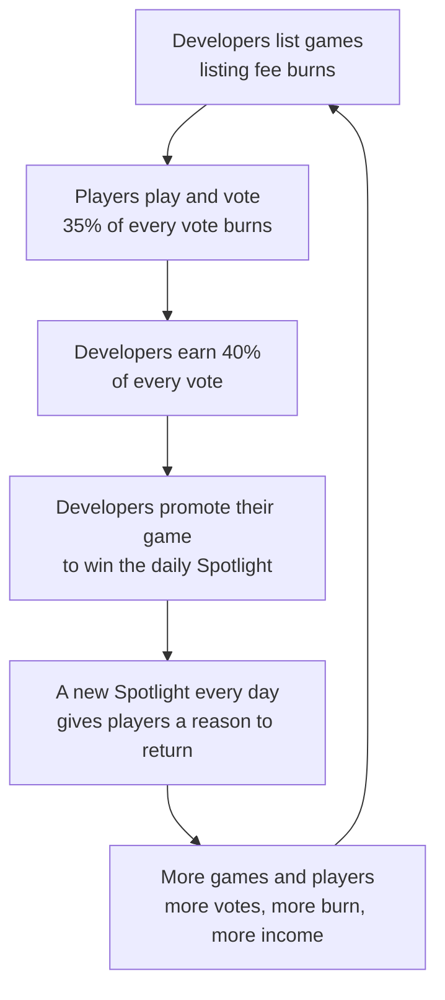

# PlayChain

**A game console on Robinhood Chain where players vote with $WIF, every vote burns $WIF and pays the game's developer, and the top game each day takes the Spotlight.**

- Live site: https://playchain-console.vercel.app (runs in demo mode until the contract is deployed)
- Contract: `PlayChainArcade` on Robinhood Chain (not deployed yet, see `DEPLOY.md`)
- Repo: https://github.com/franklin238/playchain-console
- $WIF: [`0x5173b8eA6923c2d40267890D45C46a3480954773`](https://robinhoodchain.blockscout.com/address/0x5173b8eA6923c2d40267890D45C46a3480954773)
- Made by Steeve ([@gamersteeve](https://x.com/gamersteeve))

## Quick start

You need [Node.js](https://nodejs.org) 20 or newer.

- **Windows:** double-click **`Start PlayChain.bat`**. The first run installs packages (about a minute), then your browser opens at http://localhost:5173. Keep the window open while you play.
- **Mac or Linux:**

  ```bash
  cd web
  npm install
  npm run dev -- --open
  ```

No wallet or tokens are needed. Until a contract address is set, the site runs in **demo mode** (below) and every game is playable. The four games also open on their own at `/games/neon-tide/`, `/games/hollow-kingdom/`, `/games/signal-lost/` and `/games/gloam-vesper/`.

### Demo mode

Before `VITE_ARCADE_ADDRESS` is set, PlayChain runs a simulated arcade in your browser (`web/src/arcade/demo.ts`) with the same rules as the contract:

- **Demo wallet:** Connect wallet → *Demo wallet* gives you 5,000 test $WIF (and a faucet for more). No extension, nothing real.
- **Votes split exactly like the contract:** 35% burned, 40% to the game's developer, 25% to the treasury; a developer's vote on their own game burns the developer share too.
- **Live Race and Spotlight:** the game with the most votes today (UTC day) holds the Spotlight, and loses it the moment another game out-votes it. The demo starts with three days of history, and other players keep voting while you watch.
- **Activity:** the feed, the total burned and paid out, and leaderboards for games, developers and voting streaks all update as you vote. *Reset demo* on the home page starts it fresh.

Once the contract is deployed and its address configured, the same screens read and write Robinhood Chain instead.

### What's in this folder

| Folder | What it is |
|---|---|
| `web/` | The PlayChain site (React + Vite) |
| `web/public/games/` | The four games: Neon Tide, Hollow Kingdom, Signal Lost, GLOAM: VESPER |
| `contracts/` | The `PlayChainArcade` Solidity contract and its Foundry tests |
| `DEPLOY.md` | How to deploy the contract and switch the site to live voting |

### The games

All four are original and run sandboxed in the console with no wallet access. Every sound is synthesised in the browser.

| Game | What it is |
|---|---|
| **Neon Tide** | A 3D arcade racer on a glowing sea (Three.js). Steer through gates, collect orbs, use boost fuel; 12 levels with star ratings and a music score that builds with your combo. |
| **Hollow Kingdom** | A day and night castle builder. By day, send villagers to quarry, chop, farm, mine iron and rebuild halls; by night, hold both walls against hordes of Hollow with guards, soldiers, towers, powers and Armory weapons. Twelve kingdoms, each with its own castle, rooms, weather and twist, each harder than the last; restore every hall to win one and unlock the next. 74 medals (10 Legendary) and an ending after the last kingdom. |
| **Signal Lost** | A relay puzzle game: rotate and place tiles to carry coloured signals to every receiver. 271 solver-verified sectors across 9 regions (the last 70 are the hardest), two hints per sector, a Daily Signal, Static Storm mode, achievements and 8 star awards. |
| **GLOAM: VESPER** | A hand-etched stealth puzzle platformer about private money on public chains (Phaser 3). Play Vesper the courier, slip through towns where every wall remembers, and deliver sealed letters past readers and front-runners. Narrated story, field notes, keepsakes and a Seal Book. Its single-file build is wrapped by `web/scripts/wrap-vesper.mjs` so it saves through PlayChain. |

### The console

Keyboard, gamepad, mouse and touch all work. In **Settings** you can pick one of 7 colour themes, 18 backgrounds (most of them animated) and 5 menu music tracks. PlayChain opens in fullscreen on your first click, and every game plays fullscreen. Esc always means back; leave fullscreen with the button in the top bar.

---

## 1. The problem

Onchain games have no home where players decide what gets seen and developers get paid for it. Launchpads rank by who pays for placement. Game portals pay developers through opaque ad splits, if at all. And a token that wants to be a "voting layer" needs something real for people to vote on.

## 2. How it works

PlayChain is a console-style home screen for web3 games. Players browse a shelf, play games inside the console, and vote for the ones they like with $WIF.

- **Developers list games** by calling `listGame(metadataURI)`. The listing fee (100 WIF at launch) is burned in full.
- **Players vote** with `vote(gameId, amount)` (minimum 100 WIF). Each vote is split in the same transaction:
  - **35% burned** (sent to `0x…dEaD`)
  - **40% to the game's developer**
  - **25% to the PlayChain treasury** (the owner can change the split later within onchain caps: treasury at most 40%, burn at least 20%)
- **Self-votes:** if the developer votes for their own game, the 40% developer share is burned too. They can still push their game, but never at a discount.
- **Spotlight:** the contract tracks the leading game of each daily epoch on every vote. Today's leader is the Spotlight, the hero on the home screen, and it changes as soon as another game takes the lead; until anyone votes on a new day, yesterday's winner keeps it. Today's ranking shows as the Live Race.



### Worked example (launch split 35/40/25)

| Action | Amount | Burned | Developer | Treasury |
|---|---|---|---|---|
| Dev lists game #1 | 100 WIF | 100 | 0 | 0 |
| Player votes for #1 | 300 WIF | 105 | 120 | 75 |
| Dev of #1 votes for #1 (self-vote) | 200 WIF | 150 | 0 | 50 |
| Player votes (rounding) | 101 WIF | 35.35 (takes the remainder) | 40.4 | 25.25 |

In code every amount is in base units: `toDev = amount * devBps / 10_000`, `toTreasury = amount * treasuryBps / 10_000`, `burned = amount - toDev - toTreasury`.

### The flywheel



Every step pulls people back to $WIF: developers need it to list, players need it to vote, developers receive it when people vote, and the daily Spotlight resets every 24 hours.

## 3. How $WIF is used on Robinhood Chain

| Use | Contract call | Where the $WIF goes |
|---|---|---|
| Listing a game | `listGame(uri)` | 100% to the burn address |
| Voting | `vote(id, amount)` | burn / developer / treasury, straight from the voter |
| Developer income | inside `vote` | developer wallet, same transaction |
| Treasury | inside `vote` | treasury wallet, 25% at launch, capped at 40% onchain |

The contract never holds $WIF. Every transfer is `safeTransferFrom(voter, destination)`.

## 4. Going live

PlayChain runs in demo mode until the contract is deployed. `DEPLOY.md` walks through testing, deploying and verifying the contract, pointing the site at it and listing the four games.

## 5. Architecture

```
contracts/   Solidity 0.8.24, Foundry, OpenZeppelin v5
  src/PlayChainArcade.sol           listings, votes, epochs, Spotlight
  test/PlayChainArcade.t.sol        42 unit + fuzz tests
  test/PlayChainArcade.invariant.t.sol   4 invariants
  test/PlayChainArcade.fork.t.sol   runs against the real $WIF on a mainnet fork
  script/Deploy.s.sol, ListDemoGames.s.sol
web/         Vite, React 19, TypeScript, Tailwind, wagmi core + viem
  src/arcade/        onchain state (games, epoch, Spotlight, Live Race), activity feed from events
  src/web3/          wallet, RPC with fallback, exact-amount approvals, transactions
  src/games/         meta.json validation, sandboxed game bridge
  src/screens/       Home, Game, Player, Developers, Activity, About, Settings
  public/games/      Neon Tide, Hollow Kingdom, Signal Lost, GLOAM: VESPER
  tests/unit/        Spotlight and race logic, meta validation, bridge, security headers, every game's meta.json and cover
  tests/e2e/         mainnet-fork setup + browser test of the full vote flow
```

### Contract summary

| Function | Who | What |
|---|---|---|
| `listGame(uri)` | anyone | burns the listing fee, assigns the next id |
| `updateGame(id, uri)` | that game's developer | new metadata URI |
| `vote(id, amount)` | anyone | split, epoch tally, leader update |
| `currentEpoch()`, `epochEndsAt(e)` | view | daily epochs from deploy time |
| `getGame`, `getGames(offset, limit)`, `getEpochVotes(e, ids)`, `previewSplit` | view | reads for the console |
| `setFees`, `setTreasury`, `setGameActive`, `pause`, `unpause` | owner | capped admin, moderation |

### Security notes

- **No custody.** Tokens go from the voter straight to the burn address, developer and treasury. An invariant test checks the contract balance is always 0.
- **Capped owner powers.** Fee changes must sum to 100%, treasury share at most 40%, burn share at least 20%, minimum vote above 0. The owner can pause, hide abusive listings and change the treasury address. The owner can never move anyone's tokens. Ownership uses two-step transfer.
- **Self-vote rule** stops developers from buying the Spotlight at a 40% discount.
- **Ties** go to the game that reached the top total first (strictly greater to take the lead).
- **Exact approvals.** The console approves only the amount being spent, never unlimited.
- **Games are sandboxed.** Each game runs in `sandbox="allow-scripts allow-pointer-lock"` (never with `allow-same-origin`), so it runs in an opaque origin with no access to the console, the wallet or storage. The console validates every message a game sends and ignores anything else. Scores are display only.
- **Allowlisted game origins**, so a listing can't point players at an arbitrary site.
- **Strict CSP** on console pages (`frame-ancestors 'none'`, no inline script). Game pages get their own policy that only lets this site frame them.
- **Test coverage:** 100% lines, statements, branches and functions on `PlayChainArcade.sol`.
- **Slither:** 2 findings, both informational. `timestamp` flags `voter == dev` in `_split` (a false positive, the comparison is an address check; epochs do use `block.timestamp` by design, with day-long windows). `unindexed-event-address` on `TreasuryUpdated`, which is an admin-only event.
- **Token check.** The fork test confirmed $WIF charges no fee on transfer, so the split math holds.

## 6. Run it locally

Contracts:

```bash
git submodule update --init --recursive
cd contracts
forge test
forge test --match-path test/PlayChainArcade.fork.t.sol --fork-url https://rpc.mainnet.chain.robinhood.com
forge coverage --report summary --no-match-path test/PlayChainArcade.fork.t.sol
```

Console:

```bash
cd web
npm install --legacy-peer-deps
npm test
npm run dev            # http://localhost:5173, demo mode until VITE_ARCADE_ADDRESS is set
```

Full end-to-end rehearsal on a mainnet fork (real $WIF, local test wallets): see `web/tests/e2e/fork-setup.sh`.

## 7. List your own game

1. Host an HTML5 build (canvas, Phaser, Godot or Unity WebGL export) on https.
2. Put a `meta.json` next to it:

```json
{
  "name": "My Game",
  "slug": "my-game",
  "tagline": "One line that sells it.",
  "description": "Short paragraph, max 400 chars.",
  "genre": "Action",
  "developer": { "name": "You", "x": "yourhandle" },
  "cover": "https://your-site/games/my-game/cover.png",
  "playUrl": "https://your-site/games/my-game/index.html",
  "controls": "Arrows to move, Space to jump",
  "version": "1.0.0"
}
```

3. Ask on X ([@gamersteeve](https://x.com/gamersteeve)) for your domain to be added to the play allowlist.
4. Open **Developers** on the site, paste the URL, check the tile preview, then Approve and List. The fee burns and your game is on the shelf.
5. Optional: talk to the console with `postMessage` to `window.parent`: `playchain:ready`, `playchain:score`, `playchain:exit`, `playchain:save`, `playchain:load`. The console answers `playchain:loaded`, and sends `playchain:pause` / `playchain:resume`.

## 8. Built with

Robinhood Chain, $WIF, OpenZeppelin, Foundry, viem, wagmi, React, Vite and Tailwind. Everything else is original: the `PlayChainArcade` contract and its tests, the console, the sandboxed game player, and the four games **Neon Tide**, **Hollow Kingdom**, **Signal Lost** and **GLOAM: VESPER**, including all their music and sound.

## 9. Roadmap

- Gamepad navigation polish and a TV mode
- More games from outside developers, with a self-serve allowlist
- Developer analytics: votes and earnings per day
- Tournaments and ranked daily seeds with replay-verified scores (each game's spec already designs this)
- Per-game onchain cosmetics and soulbound achievements

## 10. Disclaimer and licence

PlayChain is an independent project, not affiliated with, endorsed by, or connected to Robinhood Markets, Inc. $WIF is used to vote here and comes with no promise of value or return.

MIT licence. See `LICENSE`. Game assets are generated in code; see each game's `CREDITS.md`.
