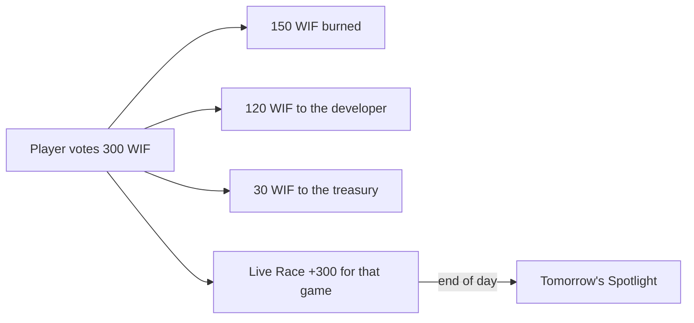
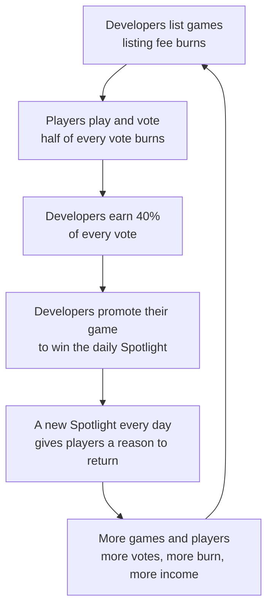

# PlayChain Flat

**A game console on Robinhood Chain where players vote with $WIF, every vote burns $WIF and pays the game's developer, and the top game each day takes the Spotlight.**

- Live site: `https://playchain-flat.vercel.app` (fill in after deploy)
- Demo video: (fill in)
- Contract: `PlayChainArcade` at `0x…` on Robinhood Chain (fill in after deploy, link to Blockscout)
- $WIF: [`0x5173b8eA6923c2d40267890D45C46a3480954773`](https://robinhoodchain.blockscout.com/address/0x5173b8eA6923c2d40267890D45C46a3480954773)

Built for the [World is Flat hackathon](https://worldisflat.fun/build). Categories: games, social and creators, tools and infra.

---

## 1. The problem

Onchain games have no home where players decide what gets seen and developers get paid for it. Launchpads rank by who pays for placement. Game portals pay developers through opaque ad splits, if at all. And a token that wants to be a "voting layer" needs something real for people to vote on.

## 2. How it works

PlayChain Flat is a console-style home screen for web3 games. Players browse a shelf, play games inside the console, and vote for the ones they like with $WIF.

- **Developers list games** by calling `listGame(metadataURI)`. The listing fee (1,000 WIF by default) is burned in full.
- **Players vote** with `vote(gameId, amount)` (minimum 100 WIF). Each vote is split in the same transaction:
  - **50% burned** (sent to `0x…dEaD`)
  - **40% to the game's developer**
  - **10% to the PlayChain treasury**
- **Self-votes:** if the developer votes for their own game, the 40% developer share is burned too. They can still push their game, but never at a discount.
- **Spotlight:** the contract tracks the leading game of each daily epoch on every vote. Yesterday's winner is today's Spotlight, the hero on the home screen. Today's ranking shows as the Live Race.



### Worked example (default 50/40/10)

| Action | Amount | Burned | Developer | Treasury |
|---|---|---|---|---|
| Dev lists game #1 | 1,000 WIF | 1,000 | 0 | 0 |
| Player votes for #1 | 300 WIF | 150 | 120 | 30 |
| Dev of #1 votes for #1 (self-vote) | 200 WIF | 180 | 0 | 20 |
| Player votes (rounding) | 101 WIF | 50.5 (takes the remainder) | 40.4 | 10.1 |

In code every amount is in base units: `toDev = amount * devBps / 10_000`, `toTreasury = amount * treasuryBps / 10_000`, `burned = amount - toDev - toTreasury`.

### The flywheel



Every step pulls people back to $WIF: developers need it to list, players need it to vote, developers receive it when people vote, and the daily Spotlight resets every 24 hours.

## 3. How $WIF is used on Robinhood Chain

| Use | Contract call | Where the $WIF goes |
|---|---|---|
| Listing a game | `listGame(uri)` | 100% to the burn address |
| Voting | `vote(id, amount)` | burn / developer / treasury, straight from the voter |
| Developer income | inside `vote` | developer wallet, same transaction |
| Treasury | inside `vote` | treasury wallet, capped at 20% onchain |

The contract never holds $WIF. Every transfer is `safeTransferFrom(voter, destination)`.

## 4. Real mainnet transactions

Fill in after the mainnet deploy (see `DEPLOY.md`).

| What | Transaction |
|---|---|
| Deploy PlayChainArcade | |
| Source verified on Blockscout | |
| List Neon Tide (1,000 WIF burned) | |
| List Hollow Kingdom | |
| List Signal Lost | |
| List Rise of Gamdom Man | |
| Votes 1 to 10 (3+ wallets) | |
| Self-vote (developer share burned) | |
| Epoch rollover: first Spotlight winner | |

## 5. Architecture

```
contracts/   Solidity 0.8.24, Foundry, OpenZeppelin v5
  src/PlayChainArcade.sol           listings, votes, epochs, Spotlight
  test/PlayChainArcade.t.sol        41 unit + fuzz tests
  test/PlayChainArcade.invariant.t.sol   4 invariants
  test/PlayChainArcade.fork.t.sol   runs against the real $WIF on a mainnet fork
  script/Deploy.s.sol, ListDemoGames.s.sol
web/         Vite, React 19, TypeScript, Tailwind, wagmi core + viem
  src/arcade/        onchain state (games, epoch, Spotlight, Live Race), activity feed from events
  src/web3/          wallet, RPC with fallback, exact-amount approvals, transactions
  src/games/         meta.json validation, sandboxed game bridge
  src/screens/       Home, Game, Player, Developers, Activity, About, Settings
  public/games/      Neon Tide, Hollow Kingdom, Signal Lost, Rise of Gamdom Man
  tests/unit/        Spotlight and race logic, meta validation, bridge, security headers
  tests/e2e/         mainnet-fork setup + browser test of the full vote flow
```

### Contract summary

| Function | Who | What |
|---|---|---|
| `listGame(uri)` | anyone | burns the listing fee, assigns the next id |
| `updateGame(id, uri)` | that game's developer | new metadata URI |
| `vote(id, amount)` | anyone | split, epoch tally, leader update |
| `currentEpoch()`, `epochEndsAt(e)` | view | daily epochs from deploy time |
| `getGame`, `getGames(offset, limit)`, `getEpochVotes(e, ids)`, `previewSplit` | view | reads for the console |
| `setFees`, `setTreasury`, `setGameActive`, `pause`, `unpause` | owner | capped admin, moderation |

### Security notes

- **No custody.** Tokens go from the voter straight to the burn address, developer and treasury. An invariant test checks the contract balance is always 0.
- **Capped owner powers.** Fee changes must sum to 100%, treasury share at most 20%, burn share at least 20%, minimum vote above 0. The owner can pause, hide abusive listings and change the treasury address. The owner can never move anyone's tokens. Ownership uses two-step transfer.
- **Self-vote rule** stops developers from buying the Spotlight at a 40% discount.
- **Ties** go to the game that reached the top total first (strictly greater to take the lead).
- **Exact approvals.** The console approves only the amount being spent, never unlimited.
- **Games are sandboxed.** Each game runs in `sandbox="allow-scripts allow-pointer-lock"` (never with `allow-same-origin`), so it runs in an opaque origin with no access to the console, the wallet or storage. The console validates every message a game sends and ignores anything else. Scores are display only.
- **Allowlisted game origins** for the hackathon, so a listing can't point players at an arbitrary site.
- **Strict CSP** on console pages (`frame-ancestors 'none'`, no inline script). Game pages get their own policy that only lets this site frame them.
- **Test coverage:** 100% lines, statements, branches and functions on `PlayChainArcade.sol`.
- **Slither:** 2 findings, both informational. `timestamp` flags `voter == dev` in `_split` (a false positive, the comparison is an address check; epochs do use `block.timestamp` by design, with day-long windows). `unindexed-event-address` on `TreasuryUpdated`, which is an admin-only event.
- **Token check.** The fork test confirmed $WIF charges no fee on transfer, so the split math holds.

## 6. Run it locally

Contracts:

```bash
git submodule update --init --recursive
cd contracts
forge test
forge test --match-path test/PlayChainArcade.fork.t.sol --fork-url https://rpc.mainnet.chain.robinhood.com
forge coverage --report summary --no-match-path test/PlayChainArcade.fork.t.sol
```

Console:

```bash
cd web
npm install
npm test
npm run dev            # http://localhost:5173, preview mode until VITE_ARCADE_ADDRESS is set
```

Full end-to-end rehearsal on a mainnet fork (real $WIF, local test wallets): see `web/tests/e2e/fork-setup.sh`.

## 7. List your own game

1. Host an HTML5 build (canvas, Phaser, Godot or Unity WebGL export) on https.
2. Put a `meta.json` next to it:

```json
{
  "name": "My Game",
  "slug": "my-game",
  "tagline": "One line that sells it.",
  "description": "Short paragraph, max 400 chars.",
  "genre": "Action",
  "developer": { "name": "You", "x": "yourhandle" },
  "cover": "https://your-site/games/my-game/cover.png",
  "playUrl": "https://your-site/games/my-game/index.html",
  "controls": "Arrows to move, Space to jump",
  "version": "1.0.0"
}
```

3. For the hackathon, ask for your domain to be added to the play allowlist.
4. Open **Developers** on the site, paste the URL, check the tile preview, then Approve and List. The fee burns and your game is on the shelf.
5. Optional: talk to the console with `postMessage` to `window.parent`: `playchain:ready`, `playchain:score`, `playchain:exit`, `playchain:save`, `playchain:load`. The console answers `playchain:loaded`, and sends `playchain:pause` / `playchain:resume`.

## 8. What existed before, and what was built during the hackathon

**Existed before the hackathon:** Robinhood Chain, $WIF, OpenZeppelin, Foundry, viem, wagmi, React, Vite, Tailwind. From Steeve's main PlayChain project (a separate, Solana-first console): the console shell this build starts from (keyboard and gamepad focus navigation, boot screen, wallpapers, settings and UI controls), the three cover artworks, and the game **Rise of Gamdom Man** (only its integration here is new).

**Built during the hackathon (this repo):** the `PlayChainArcade` contract and all its tests and scripts; the Robinhood Chain wallet, data and transaction layer; the Spotlight, Live Race, vote sheet, Developers, Activity and About screens; the sandboxed game player and bridge; the security headers for the single-origin deploy; and the three games **Neon Tide**, **Hollow Kingdom** and **Signal Lost**, built from their design specs.

## 9. Roadmap

- Gamepad navigation polish and a TV mode
- More games from outside developers, with a self-serve allowlist
- Developer analytics: votes and earnings per day
- Tournaments and ranked daily seeds with replay-verified scores (each game's spec already designs this)
- Per-game onchain cosmetics and soulbound achievements

## 10. Disclaimer and licence

PlayChain Flat is an independent project, not affiliated with, endorsed by, or connected to Robinhood Markets, Inc. $WIF is used to vote here and comes with no promise of value or return.

MIT licence. See `LICENSE`. Game assets are generated in code; see each game's `CREDITS.md`.
